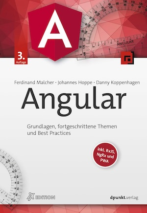

# BookMonkey 5 API

Backend for the [BookMonkey 5](https://github.com/angular-buch/book-monkey5) demo.  
A publicly available server is hosted at [api5.angular-buch.com](https://api5.angular-buch.com).  
The API is fully described via swagger. Explore it [here](https://api5.angular-buch.com/swagger-ui/).


# The book

<!-- [](https://angular-buch.com/) -->

This backend is used to explain HTTP communication with Angular.  
Read more about Angular in our book. Visit [angular-buch.com](https://angular-buch.com/) for more information (German only).


## Install & Start

You might want to extend or modify the project.  
Execute the following commands to start the standalone-server:

```
git clone https://github.com/angular-buch/api5.git
cd api5
npm install
npm start
```

Open __http://localhost:3000/__ in your browser.
All data lives in memory: a restart (or `DELETE /books`) brings back the initial book list.

Node.js 24 runs the TypeScript sources directly, there is no build step.
For development with automatic restart on changes, use `npm run start:dev`.


## OpenAPI

The specification at [/swagger.json](https://api5.angular-buch.com/swagger.json) is generated from the code: every route is registered together with its documentation (`src/openapi.ts`), the models are zod schemas (`src/schemas.ts`). The schemas only describe the API, requests are not validated against them.


## Checks

```
npm run typecheck
npm test
```

Pushes to `main` run these checks and publish the sources to `book-monkey5/api5-build`, from where Koyeb deploys the server.

# License

Code released under the [MIT license](LICENSE).
